# Doctor Tracker — Web app

Doctor Tracker gives hospital and clinic administrators one secure place to manage their doctors and the patients each doctor looks after. Staff sign in, register doctors, add patients under the right doctor and find anyone in a few keystrokes, while a live dashboard turns the records into a ward-board view — how many patients are stable, recovering or critical, which doctors carry the heaviest load, and how admissions are trending — so problems are visible before someone has to go looking for them. This repository is the Next.js web app; it talks to the Doctor Tracker REST API in the backend repository.

| | |
| --- | --- |
| **Stack** | Next.js 16 (App Router) · React 19 · TypeScript · Tailwind CSS 4 · NextAuth · TanStack Query · React Hook Form + Zod · Recharts · Radix UI |
| **Contents** | [Features](#features) · [Setup guide](#setup-guide) · [System architecture](#system-architecture) · [Technical decisions](#technical-decisions) · [Deploy](#deploy-to-vercel) · [Visual evidence](#visual-evidence) |

---

## Features

**Authentication** — Email and password sign-in through NextAuth. Every page except `/login` is guarded before it renders, sessions renew silently, and roles are enforced: admins can delete, staff can view, add and edit.

**Doctors** — Add, edit and delete doctors (name, specialization, hospital, phone, email). Search, filter by specialization, hospital and date added, sort and paginate. Each doctor has a page with their details, their patients broken down by condition, and their own patient list, where you add patients under them or remove patients from their list.

**Patients** — One page for every patient: search by name, phone, email or diagnosis; filter by condition (several at once), admission date range, doctor, gender and age group; sort; paginate; edit (including moving a patient to another doctor) and delete.

**Dashboard** — Total doctors and patients, a census bar of patients by condition, admissions over time (7 days to 12 months, in the viewer's timezone), patients per doctor, age groups, gender, doctors by specialization and the latest patients. Every figure links to the filtered list behind it.

**Experience** — Pages arrive already filled with data from the server; filters live in the URL (shareable, survive reloads, work with the back button); search waits for you to stop typing; results stay on screen, dimmed, while the next ones load; server errors appear on the right form field. Dark theme by default with a light option, responsive down to phone width (cards instead of tables, bottom-sheet forms, drawer navigation), keyboard focus and screen-reader labels throughout, checked with axe-core.

---

## Setup guide

**Requirements:** Node.js 20+ and the Doctor Tracker API running locally (see the backend repository's setup guide — it also seeds demo data).

```bash
git clone <this repository> doctor-tracker-web
cd doctor-tracker-web
npm install
cp .env.example .env.local      # then set NEXTAUTH_SECRET (command below)
npm run dev                     # http://localhost:3000
```

Generate a secret: `node -e "console.log(require('crypto').randomBytes(32).toString('base64'))"`

Sign in with the API's seeded admin, **admin@doctortracker.com / Admin@12345** — the login page's **Fill in** button enters it for you.

### Environment variables (`.env.example`)

| Variable | Purpose |
| --- | --- |
| `NEXT_PUBLIC_API_URL` | API base URL, e.g. `http://localhost:5000/api` |
| `API_URL` | Optional server-only URL for the same API (for example an internal hostname); defaults to `NEXT_PUBLIC_API_URL` |
| `NEXTAUTH_URL` | This app's public URL |
| `NEXTAUTH_SECRET` | Encrypts the session cookie |
| `NEXT_PUBLIC_DEMO_EMAIL` / `NEXT_PUBLIC_DEMO_PASSWORD` | Shows the demo sign-in shortcut; leave empty in production |

### Scripts

| Script | What it does |
| --- | --- |
| `npm run dev` | Development server |
| `npm run build` / `npm start` | Production build and server |
| `npm run typecheck` | TypeScript |
| `npm run lint` | ESLint (Next.js core-web-vitals and TypeScript rules) |

---

## System architecture

```
 Browser                          Next.js (this app)                         Express API                 MongoDB
┌──────────────────────┐        ┌─────────────────────────────────────┐    ┌──────────────────────┐   ┌──────────┐
│ Client components    │        │ proxy.ts                            │    │ /auth  login,        │   │ users    │
│  TanStack Query cache│ page   │  route guard + token refresh        │    │        refresh,      │   │ doctors  │
│  URL = filter state  │──────▶ │ Server Component pages              │───▶│        logout        │◀─▶│ patients │
│                      │◀────── │  verifySession → fetch on server →  │    │ /doctors /patients   │   │ refresh- │
│                      │ HTML + │  HydrationBoundary                  │    │ /dashboard/summary   │   │  tokens  │
│                      │ data   │ Server Actions ('use server')       │───▶│                      │   └──────────┘
│ forms ───────────────┼──────▶ │  validate → check role → call API   │    │                      │
│                      │        │ NextAuth /api/auth/* (Credentials)  │───▶│                      │
│ doctor search in     │        └─────────────────────────────────────┘    │                      │
│ pickers ─────────────┼─────────────── Bearer access token ──────────────▶│                      │
└──────────────────────┘                                                   └──────────────────────┘
```

1. **Sign-in** — the login form calls NextAuth's `signIn('credentials')`. NextAuth's server code calls `POST /auth/login`; the API returns a 15-minute access token and a 7-day, single-use refresh token, and NextAuth keeps both in its encrypted, httpOnly session cookie.
2. **Every page request** passes through `proxy.ts` (Next.js 16's middleware). Signed-out visitors are redirected to `/login?callbackUrl=…`. If the access token is within two minutes of expiring, it is rotated with `POST /auth/refresh`, and the new cookie goes both to the browser and to this request's render. Link prefetches skip the proxy, so a page full of links doesn't rotate the token once per link.
3. **Pages are Server Components.** Each one re-checks the session in the Data Access Layer (`src/server/`), fetches its data from the API on the server, and hands it to the browser's TanStack Query cache with `HydrationBoundary`. The HTML arrives with the data in it; `loading.tsx` streams a skeleton the moment navigation starts.
4. **Filters, search and pagination** change the URL inside a React transition. Next.js re-renders the page on the server with the new `searchParams`; the current results stay on screen, dimmed, until the new ones arrive.
5. **Writes are Server Actions** (`features/*/actions.ts`). Each action checks the session (and the admin role for deletes), validates its input with Zod, calls the API with the user's token from the cookie and returns plain `{ ok, data }` or `{ ok: false, message, errors }`. TanStack Query then refreshes the affected lists, counts and dashboard.
6. **Browser-side reads** — the doctor search inside pickers and background refetches — send the access token from `useSession()`. A `401 TOKEN_EXPIRED` triggers one refresh and a retry; a dead session signs the user out to `/login?reason=expired`. The refresh token never reaches browser JavaScript.

### Folder structure

```
src
├── proxy.ts              route guard + server-side token refresh (link prefetches excluded)
├── app/                  routes: Server Component pages that fetch on the server · loading / error / not-found
│   ├── (app)/            dashboard · doctors · doctors/[id] · patients — inside the app shell
│   ├── login/            sign-in page
│   └── api/auth/         NextAuth route handler
├── server/               server-only Data Access Layer: session (React.cache), API client, per-request QueryClient
├── features/             one folder per domain
│   ├── dashboard/        census bar, key figures, charts, bar lists
│   ├── doctors/          queries.ts (shared by server and browser) · actions.ts ('use server') · api.ts hooks · views
│   └── patients/         the same split; the patient list is shared by /patients and each doctor's page
├── components/ui/        design-system pieces: button, inputs, dialog, menu, pagination, empty / error / loading states
├── components/filters/   date range, condition chips, filter select
├── hooks/                useUrlState, useCurrentUser
└── lib/                  NextAuth config, browser API client, Zod schemas, constants, date and URL helpers
```

---

## Technical decisions

### 1. NextAuth in front of the API's own JWTs, with refresh-token rotation

**The problem.** The API is a separate Express service with its own users and JWTs. The web app has to protect pages on the server, send a valid token with every API call, and keep people signed in for days without a long-lived token sitting in the browser.

**What we chose.** NextAuth's Credentials provider is a thin, secure session layer — not a second user database. `authorize()` forwards the email and password to the API, and the API's access and refresh tokens are stored inside NextAuth's encrypted, httpOnly cookie. Server code (pages, Server Actions) reads the access token straight from that cookie; the browser only ever sees the short-lived access token. Tokens are renewed on the server — in `proxy.ts` before a page renders, and in NextAuth's `jwt` callback for browser session reads. On the API side every refresh token works exactly once: using it returns a new pair, and replaying an old one revokes the whole session, so a stolen refresh token is caught the first time either party uses it.

| Alternative | Why not |
| --- | --- |
| JWT in `localStorage` | Any XSS can read it; pages can't be protected on the server, so they flash before redirecting. |
| One long-lived JWT, no refresh | A leaked token stays valid for days and can't be revoked. |
| Cookies set by the API only | The API and the app usually live on different domains, which makes those cookies third-party and fragile — and Next.js can't read them to guard pages. |
| NextAuth with its own database | Duplicates users and sessions the API already owns, and the API still needs a token it can verify. |

**Trade-off.** Server Components can read cookies but not write them, so a token that is about to expire must be rotated before rendering — that is why the refresh lives in `proxy.ts`, with a wider margin than the `jwt` callback.

### 2. Server Components and Server Actions, with TanStack Query and the URL as client state — instead of Redux

**The problem.** Nearly all state here is server state: lists that depend on search, filters and page number, a dashboard that depends on a date range, and changes that must update counts on several screens. The rest is small and local (is a dialog open).

**What we chose.**

- **The server fetches first.** Each page parses its `searchParams` with the same function the browser uses (`lib/url-state.ts`) and builds its request from a shared query definition (`features/*/queries.ts`). The server's data lands in the browser cache under exactly the key the browser asks for, so the first load makes no second request. Dates are interpreted in the viewer's timezone on both sides, remembered in a cookie, so date filters match too.
- **Writes are Server Actions**, thin and checked — session and role verified inside every action, input validated with Zod, only the needed fields returned — because an action can be called by a direct POST, not only from our forms.
- **TanStack Query** is the browser's cache: one mutation invalidates whole families (adding a patient refreshes patient lists, doctor counts and the dashboard), and components subscribe only to the queries they use.
- **The URL** holds filters and pagination, so `/patients?condition=critical&search=rahman` can be bookmarked, shared and reloaded.

**Why not Redux or Context.** Redux would mean hand-writing what this setup provides — loading and error flags, caching, de-duplication, cancellation, invalidation — and keeping a store in sync with the URL. A Context holding fetched data re-renders every consumer on any change. Here the URL is the single source of truth, the server does the first fetch, and only the components whose data changed re-render.

### Also worth noting

- **Responsive tables** fold less important columns into the row on narrower screens (hospital under specialization, age under the name) and pin the row-menu column, so every action stays reachable at any width.
- **Design tokens** are CSS variables with separate light and dark values; the five condition colours were checked for colour-blind separation and contrast in both themes, and every condition also carries an icon and a label.
- **Verification** — before release the production build passed an end-to-end run: data present in the server-rendered HTML, no duplicate request on first load, create / edit / remove / delete through Server Actions, not-found handling, the route guard and token rotation through `proxy.ts`.

---

## Deploy to Vercel

Deploy the API first — this app needs its URL.

1. **Import the repository** in Vercel. It is detected as Next.js; keep the default build settings.
2. **Environment variables:**

   | Variable | Value |
   | --- | --- |
   | `NEXT_PUBLIC_API_URL` | `https://<api>.vercel.app/api` |
   | `NEXTAUTH_URL` | This app's URL, e.g. `https://doctor-tracker.vercel.app` |
   | `NEXTAUTH_SECRET` | A new random value |
   | `NEXT_PUBLIC_DEMO_EMAIL` / `NEXT_PUBLIC_DEMO_PASSWORD` | Optional — shows the demo sign-in shortcut for reviewers |

3. Deploy. Then set the API's `CLIENT_URL` to this app's URL and redeploy the API, so it accepts requests from this app.

`NEXT_PUBLIC_*` values are built into the browser bundle, so redeploy after changing one.

---

## Visual evidence

Taken from the production build (`next build && next start`) with demo data. All images are in [`docs/screenshots/`](docs/screenshots).

### Desktop

**Dashboard** — census bar by condition, key figures, admissions over time, patients per doctor
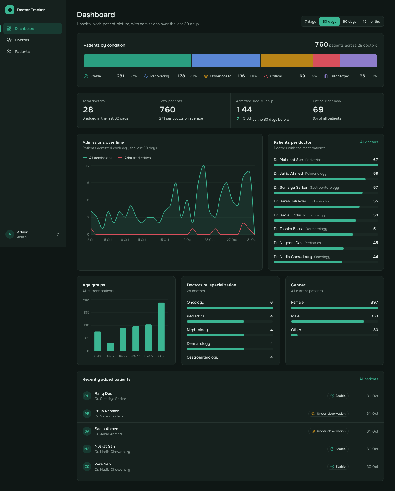

**Dashboard, light theme**
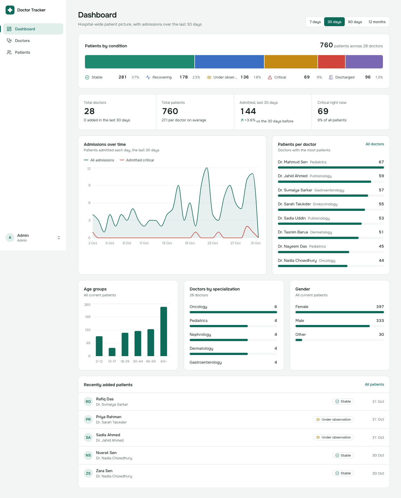

**Doctors** — search, specialization / hospital / date filters, sorting, patient load per doctor
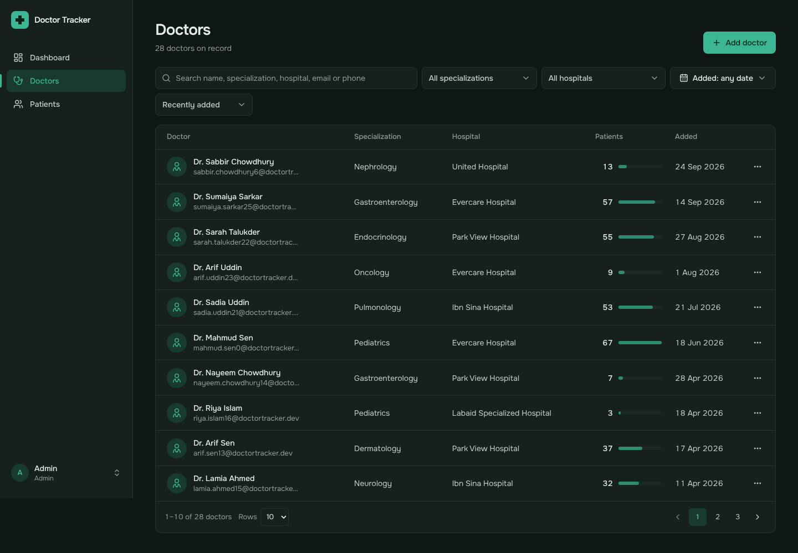

**A doctor's page** — details, patients by condition, and the doctor's own patient list
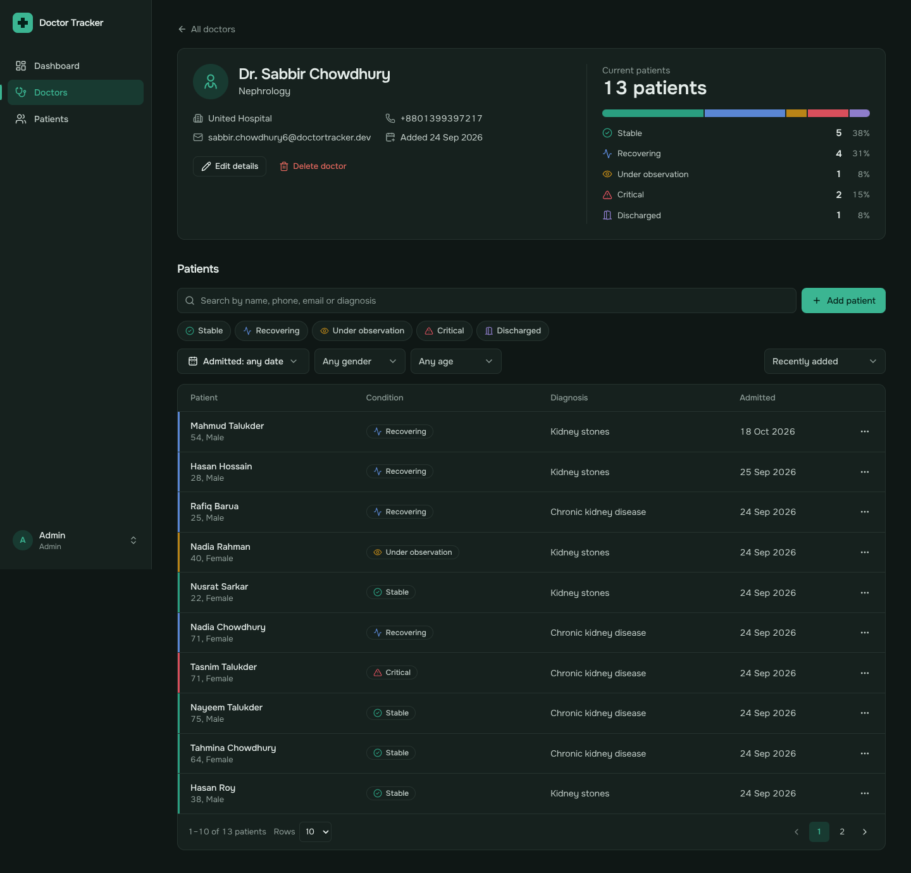

**Adding a patient under a doctor** — validation on each field
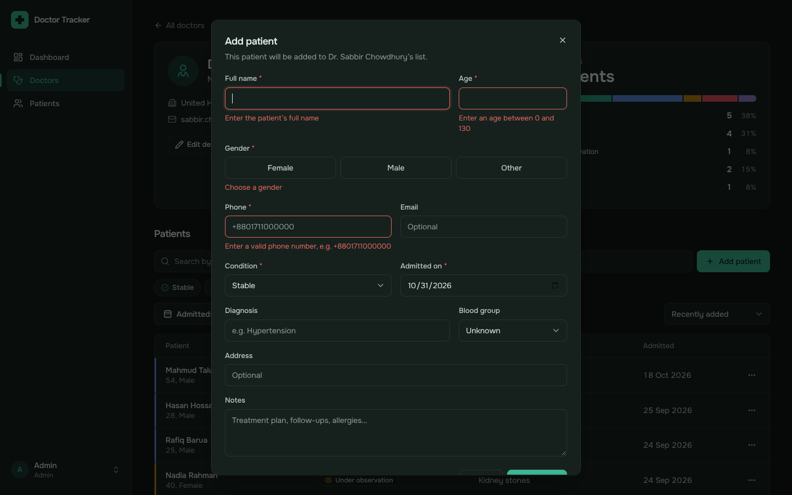

**Patients** — filtered to critical and under observation, newest admissions first
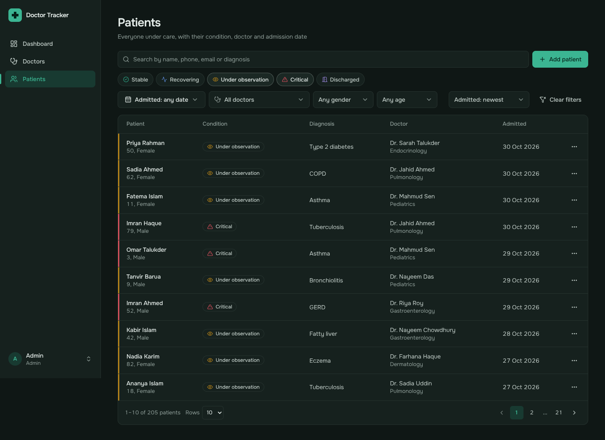

**Date range filter**
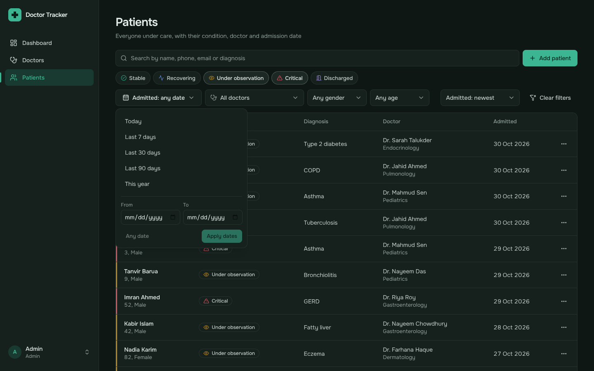

**Sign in**
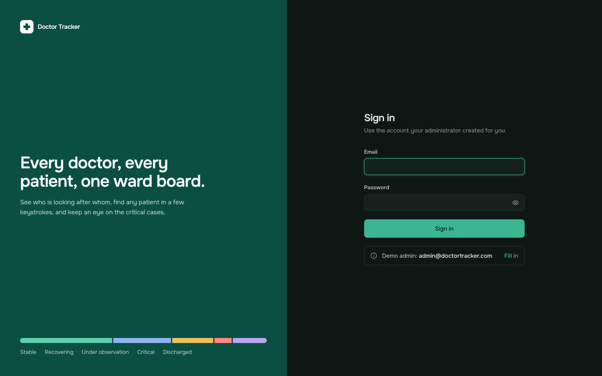

### Mobile

| Dashboard | Doctors | Patients |
| --- | --- | --- |
| 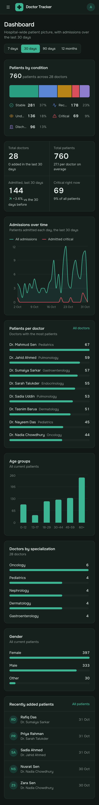 | 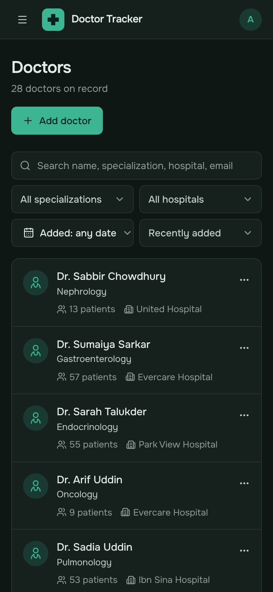 | 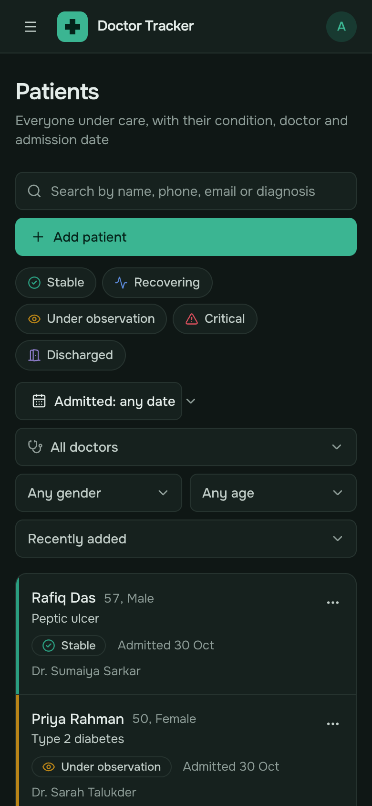 |

| Navigation | Add patient |
| --- | --- |
| 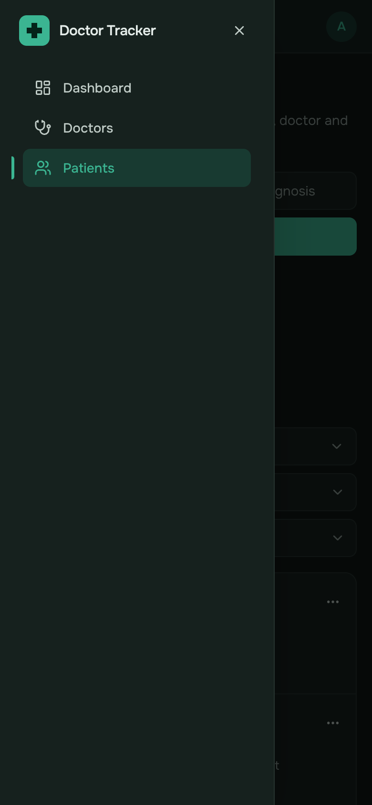 | 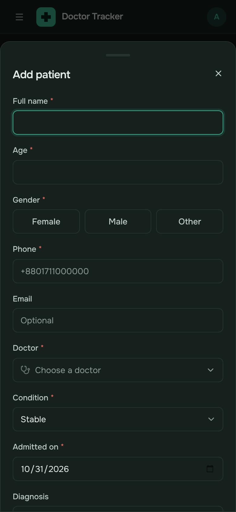 |
